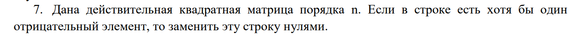
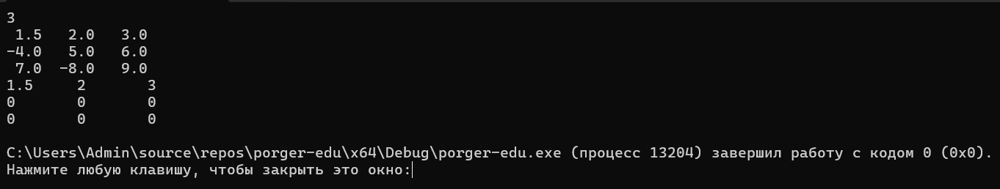
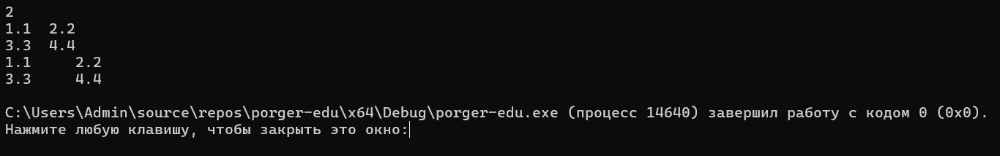

## 📋 Условие задачи

## Код решения

[main.cpp](main.cpp).

### Тест 1

**Ввод:** `3`  
`1.5   2.0   3.0`  
`-4.0  5.0   6.0`  
`7.0  -8.0   9.0`  

**Ожидаемый результат:**  
`1.5   2     3`  
`0     0     0`  
`0     0     0`  

### Тест 2

**Ввод:** `2`  
`1.1  2.2`  
`3.3  4.4`  

**Ожидаемый результат:**  
`1.1  2.2`  
`3.3  4.4`  

